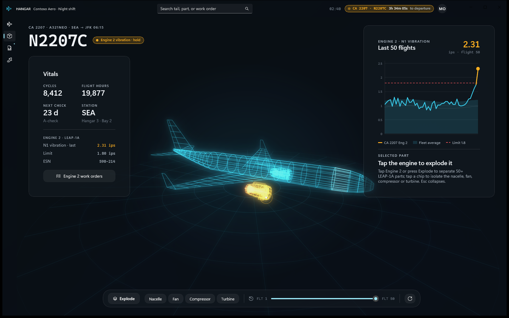
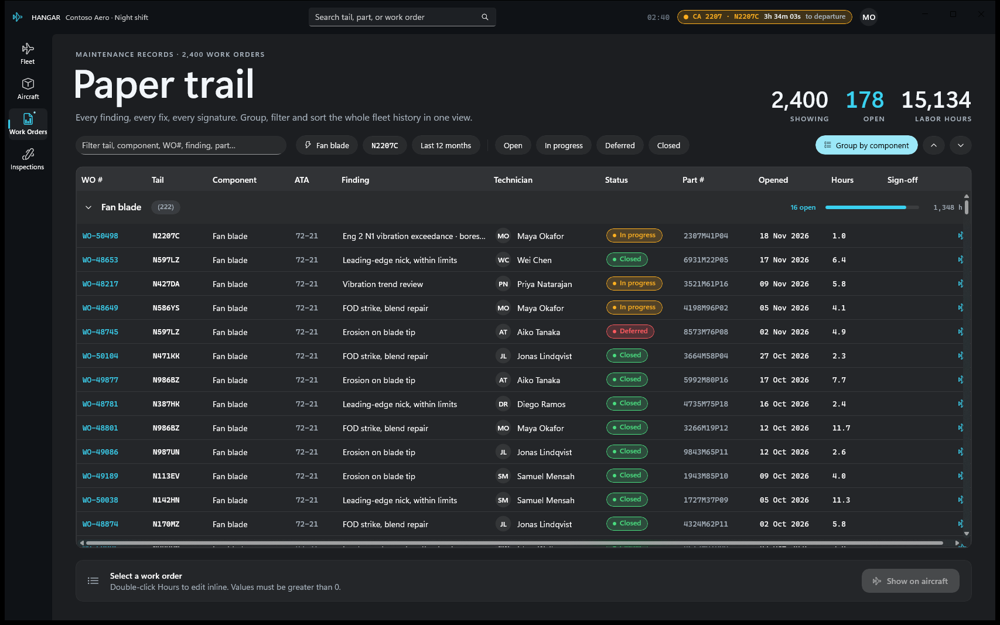
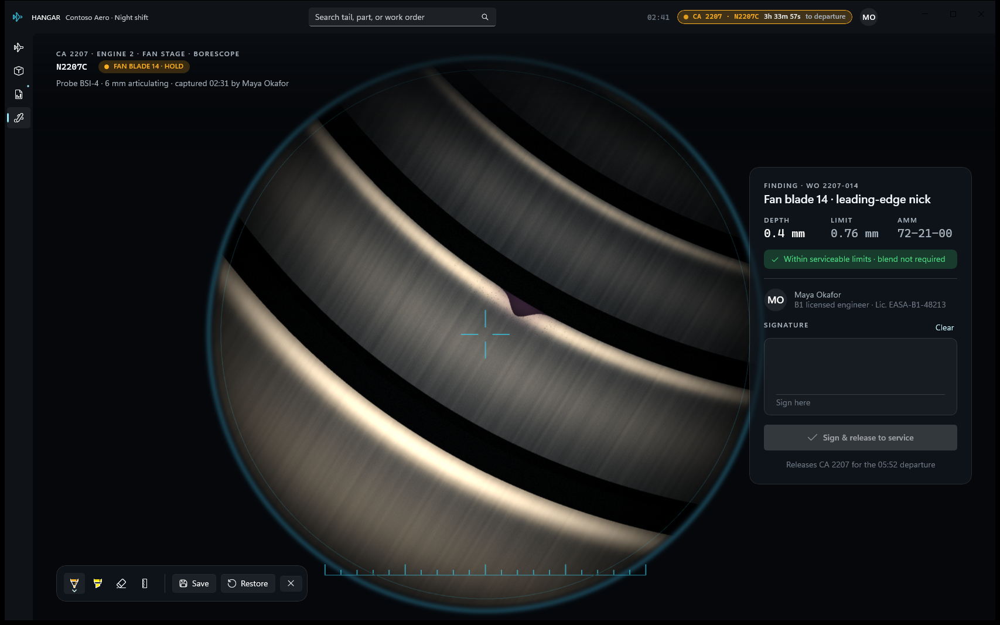
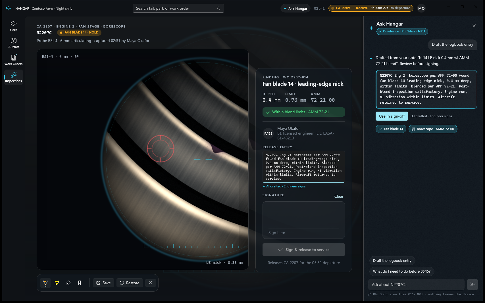

# HANGAR — by Contoso Aero

> *"It's 2:40am. One of 42 aircraft just landed with a problem — and it leaves at 6:15."*

HANGAR is a WinUI 3 line-of-business showcase built for an Ignite 2026 keynote demo. It shows a night-shift maintenance controller taking aircraft **CA 2207 (N2207C, A321neo)** from an Engine 2 vibration alert to release-to-service in about three minutes.

The full product and design spec is in [`docs/CONCEPT.md`](docs/CONCEPT.md), which covers the story, the "Night Shift" design language, the screens and the stage script.

| Fleet | Aircraft (hologram) |
|---|---|
|  |  |
| **Work Orders (TableView)** | **Inspections (InkCanvas)** |
|  |  |

Other screenshots in [`docs/screenshots`](docs/screenshots):
- **Engine 2 exploded:** `aircraft-exploded.png`, `aircraft-exploded-light.png`
- **Part zoom on the aircraft page:** `aircraft-fan.png`, `aircraft-turbine.png`
- **Fleet globe:** `aircraft-globe.png` (compact card, scrubbed to flight 44), `aircraft-globe-expanded.png`, `aircraft-globe-light.png`
- **After sign-off:** `inspections-signed.png`
- **Day-shift (Light) versions of each page:** `*-light.png`

## What's inside

| Page | Highlights |
|---|---|
| **Shell** | <ul><li>Mica Alt backdrop and an extended title bar with search (Ctrl+K) and a live departure-countdown chip</li><li>Store-style rail **NavigationView** (72px icon-over-label rail with a sliding selection pill, adapted from AI Dev Gallery's custom template; `Themes/NavigationView.xaml`)</li><li>Dark-first, with full Light and HighContrast dictionaries</li><li>`SystemAccentColor` is overridden to Runway Cyan `#3AD1F0`; Safety Amber `#FFB020` is reserved for attention states</li></ul> |
| **Ask Hangar** | <ul><li>✦ title-bar button or **Ctrl+Space**: a 420px acrylic pane slides in from the right. It is an on-device AI assistant backed by **Phi Silica** (`Microsoft.Windows.AI.Text.LanguageModel`) on the NPU, so it works with no network, which suits Maya's no-cloud, flaky-Wi-Fi hangar</li><li>Grounded in live app data (`Services/AskContextBuilder`): current page and selection, the Engine 2 vibration story (flight 44 hail at FL190 → 1.32 ips, 2.31 ips at flight 50 vs the 1.8 limit), open Engine 2 WOs, AMM 72-00 / 72-21, and last year's same fault on CA 1916</li><li>Tokens stream in with a blinking caret, and a "Thinking on NPU…" shimmer shows before the first token</li><li>Page-aware suggestion chips; typing in search offers **Ask Hangar: &lt;query&gt;**</li><li>Answers end in **action chips**: *Flight 44* scrubs and expands the globe, *Fan blade 14* explodes Engine 2 and selects the blade, *WO* chips filter the TableView, and *Borescope* opens Inspections. In live mode the chips are chosen deterministically from keywords, never trusted from model output</li><li>On Inspections, **Draft the logbook entry** turns the shorthand into a release entry and **Use in sign-off** pre-fills the notes. It never signs: *AI drafted · Engineer signs*</li><li>The badge is honest about the mode: **On-device · Phi Silica · NPU**, or **Demo responses** with a tooltip giving the reason</li></ul> |
| **Fleet** | <ul><li>4 KPI cards with sparklines</li><li>Hero 30-day availability **area Chart** with a dashed target line</li><li>ItemsRepeater grid of 42 aircraft, where CA 2207 breathes amber</li><li>Connected animation from a tile to the Aircraft page</li></ul> |
| **Aircraft** | <ul><li>Canvas-style hero layout with a **Tron-style holographic wireframe A321neo** (Win2D)</li><li>Drag to orbit, wheel to zoom, idle auto-rotate</li><li>Live **airflow** streaks through both engines: bypass streams through the fan duct, and core streams that swirl through the compressor and heat up past the combustor (they fade out when exploded)</li><li>**Tap Engine 2** (or press **Explode**) to fly the camera to a 3/4 technical-illustration view. Engine 2 then bursts into 50+ LEAP-1A parts: spinner, 22 fan blades, OGVs, booster, HPC stages, combustor, HPT/LPT stages, N1/N2 shafts, clamshell thrust reversers, exhaust and gearbox. The burst uses a staggered spring cascade with motion trails and an energy pulse; collapsing reverses the cascade</li><li>Once settled, the exploded view shows module-level callouts. Fan blade 14 turns **Critical red** (amber while collapsed = attention) with a red glow and finding callout; the rest of the aircraft fades back. Tap empty space or press Esc to collapse</li><li>**Tap the red blade tip** (or **Borescope blade 14**, or Enter) to dive the camera into the fault with a red flash; the stage then drills in to Inspections</li><li>Chips (Nacelle, Fan, Compressor, Turbine) isolate a module, fly the camera to it and switch to per-part labels with a finding callout</li><li>Glass side panels hold vitals and an Engine 2 N1 vibration **line Chart** with a fleet-average band, a limit line and an amber spike, plus a flight scrubber</li><li>**Fleet globe** (Win2D, `Controls/FleetGlobe`): an orthographic dot-matrix Earth in the same hologram language. It shows great-circle red-eye arcs, 12 airborne aircraft drawn as comets with trails, parked aircraft as dim dots, and CA 2207 as the only amber point, breathing at SEA. The flight scrubber drives it: CA 2207's leg for the scrubbed flight is drawn as an arc coloured by that flight's N1 vibration (cyan, then amber at ≥ 1.4 ips, then red above the 1.8 limit), and the globe springs to centre on that leg. **Flight 44 (DEN → SEA)** shows the crew report *"Hail encounter on climb, FL190"* as a callout chip and as a diamond marker on the vibration chart. Tap the card or press **G** to expand the globe to the full stage; the hologram shrinks toward SEA. Drag to spin and wheel to zoom; Esc or **Back to aircraft** dives back in. `AircraftPage.ScrubToFlight(int)` and `ExpandGlobe()` let other features (for example, a future *Ask Hangar* citation chip) drive it</li></ul> |
| **Work Orders** | <ul><li>First-party **TableView** with 2,400 seeded rows</li><li>Grouped by component, with templated group headers showing open count, a progress bar and hours</li><li>Filter chips, sortable headers, status pills, PersonPicture technicians and Cascadia Mono part numbers</li><li>Inline Hours editing with validation (> 0)</li><li>A **Show on aircraft** action</li></ul> |
| **Inspections** | <ul><li>Framed borescope viewport: ink is confined to the image, and the **InkToolbar** (pen, highlighter, eraser, ruler) and sign-off panel sit outside it</li><li>Arriving from the hologram, the image settles in and a red reticle lands on the blade 14 nick; a breadcrumb leads back to the exploded engine</li><li>Strokes can be saved and restored</li><li>Signing the ink signature pad and choosing **Sign & release** adds or updates WO 2207-014, flips CA 2207 to green across the app, and plays one celebratory composition moment</li></ul> |

## Tech stack

- **.NET 10**, `net10.0-windows10.0.26100.0`, packaged (MSIX), MVVM with **CommunityToolkit.Mvvm**
- **Microsoft.WindowsAppSDK 2.5.4-experimental**, which provides the first-party `TableView`, `Chart` (line/area/bar) and `InkCanvas`/`InkToolbar`
- **Microsoft.Graphics.Win2D 1.4.0** for the hologram renderer (Aircraft page)
- Local deterministic seeded data (`Services/`), with no network access
- The window is sized for **2560×1600 @ 150%**

```
Hangar/
  Views/        Fleet, Aircraft, WorkOrders, Inspections pages
  ViewModels/   CommunityToolkit.Mvvm view models
  Services/     FleetService (seeded data, demo state, reset)
  Controls/     AircraftStage (Win2D hologram),
                KPI/sparkline controls
  Helpers/      WireMesh (procedural wireframe), ThemeRes, converters
  Themes/       Semantic brushes: Dark (Default) / Light / HighContrast
```

## Build & run

Prerequisites:
- Windows 11 24H2 or later, with Developer Mode on
- .NET 10 SDK
- WinApp CLI 0.7+, installed with `winget install Microsoft.WinAppCli`

```powershell
cd Hangar
dotnet build -c Debug -p:Platform=ARM64   # or x64
winapp run .                              # registers the loose layout and launches
```

You can also open `Hangar/Hangar.csproj` in Visual Studio 2026 and press F5 with the packaged profile.

If a redeploy fails with `0x80073CF9`, pass `--output-appx-directory "$env:LOCALAPPDATA\winapp-layout\Hangar-Debug"` to `winapp run`.

## Keyboard

| Keys | Action |
|---|---|
| **Ctrl+Shift+D** | Hidden **demo reset**: restores the 02:40 state (CA 2207 on hold, signature cleared, ink cleared, filters reset) |
| Ctrl+Shift+L | Toggle Night shift / Day shift (Dark / Light) |
| Ctrl+K | Focus search |
| **Ctrl+Space** | Toggle the Ask Hangar pane (Enter sends, Esc closes) |
| Ctrl+Shift+A | Hidden: force Ask Hangar into scripted (Demo responses) mode, or back to live |
| Ctrl+E | Explode / collapse Engine 2 |
| Arrows / Home / Esc | Orbit, reset camera, deselect part (Aircraft stage focused) |
| G / Esc | Expand the fleet globe / dive back into the aircraft (Aircraft page) |
| Arrows / +/− / Home | Spin, zoom, re-centre the expanded globe |

## Demo script (3 minutes)

Press **Ctrl+Shift+D** before you go on stage.

| Time | Do | Say |
|---|---|---|
| 0:00 | Fleet: the amber CA 2207 tile is breathing | *"It's 2:40am. One of 42 aircraft just landed with a problem — and it leaves at 6:15."* |
| 0:20 | Click the tile; it connects into the Aircraft page | *"This is WinUI. Native, GPU-drawn 3D on a Surface."* |
| 0:45 | Drag to orbit, then **tap Engine 2** (it explodes); blade 14 glows red | *"Let's look inside the engine. There's our problem."* |
| 1:05 | Vibration chart: scrub the flight slider | *"The new WinUI Chart control — line, area, markers, all first-party."* |
| 1:15 | Keep scrubbing to **flight 44**: the globe arc turns red DEN → SEA and the hail chip appears. Press **G** to expand the globe and spin it, then press **Esc** to dive back into the engine | *"The chart shows when Engine 2 went bad. The globe shows where — and why. Hail on climb out of Denver. That's blade 14."* |
| 1:20 | *(Optional AI beat)* Turn on **airplane mode**, press **Ctrl+Space**, and tap **Why is 2207 held, and what changed?** The answer streams from the NPU; tap the **Fan blade 14** chip and Engine 2 explodes to the blade | *"No cloud, no Wi-Fi. Phi Silica on the NPU knows our fleet — and its answers are buttons."* |
| 1:25 | **Engine 2 work orders**: group by component, toggle the **N2207C** and **Last 12 months** chips, sort by date | *"And yes — WinUI has a TableView now. 2,400 rows, grouped, filtered, editable."* |
| 1:55 | **Engine 2 work orders**: **Show on aircraft** on the blade 14 order, then tap the red tip; the camera dives into the borescope and the reticle lands on the nick. Circle it with the pen and measure with the ruler | *"Ink is back in WinUI 3. The pen is still the best tool in the hangar."* |
| 2:30 | Sign the pad, then click **Sign & release to service**; the aircraft turns green | *"Signed, logged, airworthy. Wheels up at 5:52."* |
| 2:50 | Go back to Fleet: everything is green | *"Built entirely with WinUI and the Windows App SDK. Open source — go build yours."* |

## Known limitations & risks

### 3D (Composition Scenes)
The spec called for `Microsoft.UI.Composition.Scenes` (SceneVisual with mesh nodes). A spike showed that **procedural meshes do not render on WinAppSDK 2.5.4-experimental**: the SceneVisual is created, but no geometry appears. The spike is in commit `9033415`.

The documented fallback is a **Win2D wireframe hologram** (`Controls/AircraftStage`, `Helpers/WireMesh.cs`). It has these properties:
- Its geometry is procedural, with no glTF asset.
- It uses perspective projection and dark-theme bloom with scanlines.
- It provides per-part hit-testing, camera fly-to and an exploded view driven by springs.
- It honours `UISettings.AnimationsEnabled` and draws plain lines in Light and HighContrast.

The result is "real 3D" in the sense of a projected 3D wireframe; it is not a lit or shaded mesh.

### Experimental controls (WinAppSDK 2.5.4-experimental)

**TableView**
- Template cells need `Margin="10,0,0,0"` to align with text columns.
- There is no `ScrollIntoView`.
- `SelectedItem` is get-only, so selection is driven via the view model.

**Chart**
- The Y axis must have `IsVisible="True"` for `Minimum`/`Maximum` to apply.
- Tick `Spacing` must be ≤ the axis range.
- Gradient fills are ignored, so a solid fill with opacity is used instead.
- An `AreaSeries` stroke outlines the whole polygon, so a separate `LineSeries` draws the top edge.
- Theme resources are only read from the PRI.
- KPI **sparklines are XAML `Path`s** rather than Charts, to keep 4 extra chart instances off the Fleet page.

**Packaging**
- The experimental Charts/Tabular `.pri` resources are not merged automatically.
- The `HangarMergeExperimentalControlPri` target in `Hangar.csproj` injects them from `microsoft.windowsappsdk.winui\2.3.10-experimental`.
- If the package version changes, update that path.

**Release builds**
- Trimming may break the few `{Binding}` usages inside TableView templates.
- Demo from **Debug**, or validate Release before stage day.
- `WUI2011` analyzer warnings are expected.

### Fleet globe
- The land mask is baked at dev time from **Natural Earth 1:110m land** (public domain, [naturalearthdata.com](https://www.naturalearthdata.com/)) into a 1.5° lat/lon dot grid (`Assets/Globe/land-dots.bin`, about 5,200 dots, embedded resource). Nothing is downloaded at runtime.
- Network data (airports, CA 2207's 50 legs and the 02:40 PT red-eyes) is deterministic and seeded in `FleetDataService`. Airborne progress advances slowly in real time from the demo-reset moment.
- The globe draws with `CanvasAnimatedControl`. It pauses when not visible and drops to 30 fps while idle in compact mode.

### Ink
- There is no handwriting recognition: the note is kept as ink.
- `RenderTargetBitmap` does not capture InkCanvas strokes, so the signature preview on the work order is re-drawn from stroke points as `Path`s.

### Ask Hangar (Phi Silica)




- Live mode requires a **Copilot+ PC** with an NPU, the Phi Silica model installed via Windows Update, and the `systemAIModels` restricted capability (already in `Package.appxmanifest`).
- **Limited Access Feature unlock** (`com.microsoft.windows.ai.languagemodel`) is needed on some builds. Credentials come from one of:
  - the environment variables `HANGAR_LAF_TOKEN` and `HANGAR_LAF_ATTESTATION`;
  - an `ask-hangar.local.json` file (`{ "lafToken": "...", "lafAttestation": "..." }`) in the package `LocalState` folder or next to the exe.

  The file is git-ignored. **Never commit the token.** Without credentials the app still tries `GetReadyState()` and falls back if the feature is locked.
- **Fallback**: if the device is not supported, the model is not ready, the LAF is locked, content moderation blocks the answer, or an exception occurs, `ScriptedResponder` streams deterministic grounded answers at about 25–40 ms per token.
  - The badge then reads **"Demo responses"**, with the reason in its tooltip. When live, it reads **"On-device · Phi Silica · NPU"**.
  - **Ctrl+Shift+A** forces scripted mode for stage safety.
- Citation chips (`[[flight:44]]`, `[[part:fanblade14]]`, `[[wo:…]]`, `[[nav:…]]`) are always appended deterministically from a keyword match on the answer and grounding context. Model-emitted markers are never trusted.
- The logbook draft only **pre-fills** the Inspections release entry ("AI drafted · Engineer signs"). The engineer still signs.
- Diagnostics are logged to the debug output with the `[AskHangar]` prefix.

### Testing
- Pointer flows were verified manually and through the debug start hook, not with UI automation; the dev desktop was shared. These flows are drag-orbit, ink, signature and connected animation.
- Run the full script on the stage device before the keynote.
- **Debug start hook** (Debug builds only): put a `startpage.txt` in the package `LocalState` folder containing, for example, `Aircraft light fan` or `Inspections dark sign`. The app then opens directly to that state. It was used to capture the screenshots. Delete the file afterwards.
