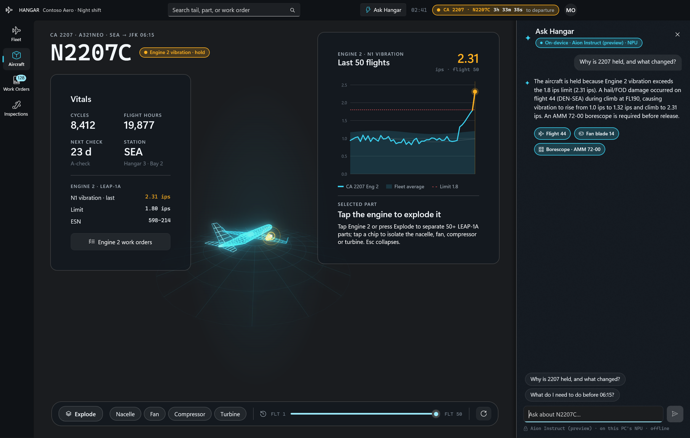

# Hangar.Reactor — porting notes

`Hangar.Reactor` is a port of the XAML `Hangar` app to [Microsoft.UI.Reactor](https://www.nuget.org/packages/Microsoft.UI.Reactor) (0.1.0-preview.16).
Every window, page and control is a Reactor component written in C#. The project contains no `.xaml` pages or `UserControl`s.

## What is shared with the XAML app

The Reactor project links these files from `..\Hangar.WinUI` (see `Hangar.Reactor.csproj`):

| Shared | Why |
|---|---|
| `Models\*`, `ViewModels\*`, `Services\FleetDataService.cs` | Same data, same demo state machine (hero aircraft, sign-off, reset) |
| `Helpers\WireMesh.cs`, `WorkOrderFormat.cs`, `Ui.cs`, `ThemeRes.cs` | Pure logic: mesh generation and formatting |
| `Themes\Colors.xaml`, `Themes\Styles.xaml` | Resource dictionaries only (Light/Dark/HighContrast brushes), so both apps use the same palette |
| `Assets\Inspection\**` | Borescope imagery |

## Layout

| File | Contents |
|---|---|
| `App.cs` | Window and titlebar, built-in `NavigationView` icon rail (styled with the XAML app's `Themes\NavigationView.xaml`), built-in `AutoSuggestBox` global search, page routing, Ctrl+Shift+L/D shortcuts, demo-reset InfoBar |
| `Kit.cs`, `Palette.cs` | Small design-system helpers: cards, chips, captions, mono text, theme brushes |
| `Charts.cs` | Sparklines and the 30-day availability chart, drawn with Win2D |
| `Hologram\HologramEngine.cs` | The wireframe aircraft and engine hologram (projection, expand, hit-testing), drawn with Win2D |
| `Pages\FleetPage.cs` | Hero, KPI cards, availability chart, fleet grid |
| `Pages\AircraftPage.cs` | Hologram stage, vitals, vibration chart, part chips, flight scrubber |
| `Pages\WorkOrdersPage.cs` | Grouped, sortable and filterable 2,400-row built-in `DataGrid<T>` with inline hours editing and a detail strip |
| `Pages\InspectionsPage.cs` | Borescope viewer with ink annotation, finding card, signature, sign & release burst |
| `Ink\InkSurface.cs` | Win2D ink surface used for annotations and the signature |

## Ask Hangar



The on-device chat pane is the one exception to "no XAML". The project links `Controls\AskHangarPane.xaml(.cs)`, `Controls\WrapPanel.cs` and the `Services\*Model*.cs`, `AskContextBuilder.cs`, `ScriptedResponder.cs` and `LocalModelService.cs` files from `..\Hangar.WinUI`, and `App.cs` hosts the pane in a 420px inline column through `XamlHostElement`. The page content reflows, as in the WinUI app.

- **`HANGAR_REACTOR` define:** compiles out the WinUI-only `NavigationService` and `Hangar.Views` references. Reactor sets `AskHangarPane.PageProvider` so suggestion chips and grounding follow the current Reactor page, and calls `RefreshSuggestions()` on navigation.
- **Backend chain:** Aion Instruct (preview) → Phi Silica → `ScriptedResponder`, with the same badge, grounding and `[[chip]]` contract. `LocalModelService.InitializeAsync` starts in the background at launch.
- **Aion:** `Hangar.Reactor.csproj` auto-enables Aion when the nupkg is in the repo's git-ignored `nuget-local\`, exactly like the WinUI project. It injects the framework and WAR 2 dependencies into a manifest copy under `obj\`, so the committed `Package.appxmanifest` stays clean. Run `scripts\Setup-Aion.ps1` once per machine.
- **Chips → Reactor navigation:**
  - Flight 44 opens Aircraft with `AircraftNavigationArgs.Flight = 44`.
  - Fan blade 14 opens Aircraft with Engine 2 expanded and the blade selected.
  - `wo:` opens Work Orders with `WorkOrdersNavigationArgs(Query)`.
  - Borescope opens Inspections.
- **Use in sign-off:** fills the Inspections RELEASE ENTRY box through `NotesPrefill`. It never signs; the caption reads "AI drafted · Engineer signs".
- **Shortcuts:** **Ctrl+Space** toggles the pane, **Ctrl+Shift+A** forces scripted mode, and **Ctrl+Shift+D** (demo reset) also clears the chat.
- **DEBUG capture:** create `LocalState\askcapture.flag` before launch to capture `ask-hangar.png`, `ask-hangar-logbook.png` and `ask-hangar-light.png` into `docs\screenshots\reactor`.

## Replacements and known limits

- **Win2D:** the hologram, charts, sparklines, ink and signature all draw through `Win2DCanvas` from `Microsoft.UI.Reactor.Advanced.Win2D`. The hologram animates from `CompositionTarget.Rendering`.
- **InkCanvas and InkToolbar:** Reactor has neither, so `InkSurface` reimplements them with pen, highlighter, stroke eraser, five colours, and JSON save/restore. Its limits:
  - It doesn't model pressure or tilt.
  - There's no ruler or stencil.
  - Strokes are smoothed polylines, not Bézier ink.
- **Built-in controls used:** `NavigationView` (rail), `AutoSuggestBox` (global search), `ToggleButton` (Group by component) and `DataGrid<T>` from `Microsoft.UI.Reactor.Advanced` (Work Orders).
- **NavigationView:** reuses the XAML app's `MainNavigationViewStyle` and item style, linked into the project as a Page. `ConfigureRail` sets per-item AutomationIds (`Nav{Tag}`), tooltips and the Work Orders `InfoBadge`.
- **AutoSuggestBox:** the untyped element is used. Reactor's typed `AutoSuggest<T>` has no renderer in preview.16. The suggestion row layout is a `DataTemplate` loaded with `XamlReader`.
- **TableView → DataGrid<T>:** the Work Orders source implements `IObservableDataSource` with server-side sort and count. Its limits:
  - **No grouping.** Component groups are emitted as header rows by the data source and drawn full-width from the first cell through a `Canvas` overflow button.
  - **Built-in "N items" row.** It always renders, and its count includes group header rows.
  - **Fixed pixel column widths** from the first render. Finding is resized to fill the page through `HeaderContext.Resize`.
  - **40px ✓ column.** Single selection mode adds it.
  - **Editor re-render.** `UpdateEditingValue` doesn't re-render, so the custom Hours editor stores validation state on the page to force one.
  - **Sorting.** It's driven by the custom header buttons (`SortBy{Column}`), descending within groups.
- **Accent toggle:** the built-in `ToggleButton` is used. Removing `.AccentButton()` on a re-render doesn't clear the style.
- **ConnectedAnimation:** not available. Page changes use a plain swap.
- **Release banner:** uses a `Storyboard` started from code.
- **Cursor:** there's no cursor modifier, so the hologram stage sets `UIElement.ProtectedCursor` through reflection (`Hologram\CursorHelper.cs`).
- **Shapes** (Ellipse/Path fills) need concrete brushes. Theme brushes are resolved via `Theme.Ref(...)` before they're assigned.
- **Borescope reticle UV:** recalibrated, because the Win2D image fit differs slightly from the XAML `Image` with `Stretch="UniformToFill"`.

## Testing notes

- DataGrid rows aren't exposed as UIA items, so row selection and inline Hours editing need real (foreground) pointer or keyboard input. Background `PostMessage` keys and background clicks don't reach them.
- Windows Sandbox (`winapp run . --on sandbox`) failed on this host with `0x80370106` (VM exited unexpectedly), so tests ran locally with background-safe UIA `invoke`/`set-value`/`screenshot`.
- AutomationIds on `Border` and `StackPanel` aren't exposed in the UIA tree. UI tests target visible text or real controls (Button, TextBox and so on).
- In DEBUG builds, `App.cs` writes first-chance, unhandled and unobserved-task exceptions to `LocalState\debug.log`.
  - Caught `COMException: No installed components were detected` entries from Reactor's `ElementPool.ForceDetach` are internal to Reactor and harmless.
- DEBUG screenshot capture:
  - Press **Ctrl+Shift+P** to capture the current page.
  - Or create `LocalState\autocapture.flag` before launch. The app then captures Fleet, Aircraft, Work Orders and Inspections in dark, plus Fleet and Work Orders in light, into `docs\screenshots\reactor`.

## Build and run

```powershell
cd Hangar.Reactor
dotnet build -p:Platform=ARM64
winapp run .
```
